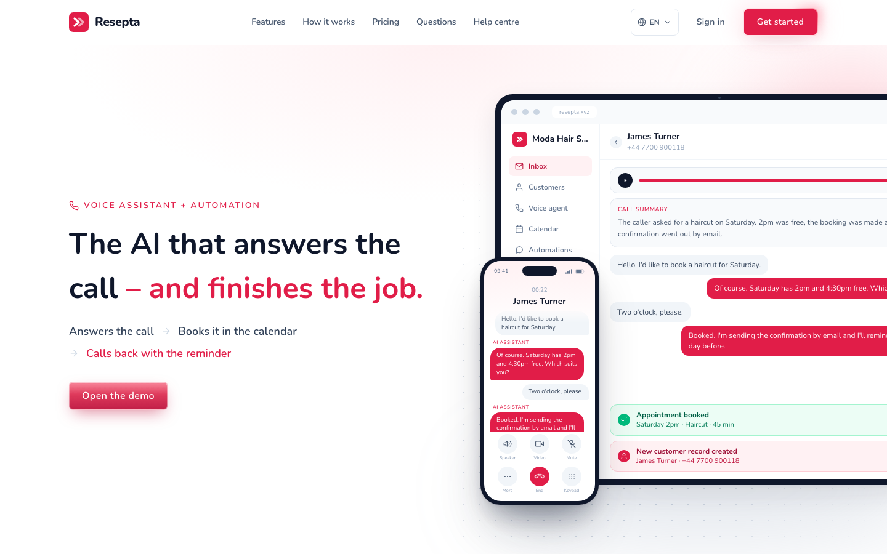

# Resepta

An AI front desk for salons, barbers and clinics. It answers the phone, books the appointment in the calendar, and sends the confirmation and reminder on WhatsApp or email.

[](https://resepta.xyz)

**[See it live](https://resepta.xyz)**

## What it does

- A phone agent per business, built on [Retell](https://www.retellai.com), that follows the business's own instructions
- Books, moves and cancels appointments during the call, and writes the result back to the customer record
- WhatsApp confirmations and reminders using approved Meta templates; customers confirm or cancel by replying
- Customers, inbox and a working calendar in one place, with optional cal.com availability
- One deployment serves many businesses, each with its own data and its own Retell account
- In Turkish, English and German

If you're building voice agents on Retell, the interesting parts are the agent tools in [`convex/agentTools.ts`](convex/agentTools.ts) and the phone-agent notes in [`docs/phone-agent.md`](docs/phone-agent.md).

## Run it

Built with Next.js, Convex and Tailwind.

```bash
npm install
npx convex dev --once --configure=new
npm run dev
```

Copy `.env.example` for the settings you need. The full setup and architecture are in the [developer guide](docs/developer-guide.md).
